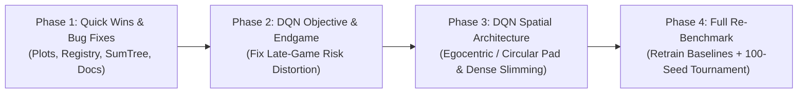

# 🕹️ Comprehensive Code Review & DQN Improvement Plan: PacMan-AI-Chronicles

**Date:** October 16, 2026  
**Status:** Deep-Dive Architecture, DQN Design/Training Audit & Strategic Improvement Plan  
**Evaluated Branch:** `main` (`ab0563e` + working tree changes)  
**Test Suite Status:** `66/66` automated unit and regression tests passing (`17.96s`)

---

## 📑 Table of Contents

1. [Executive Summary](#1-executive-summary)
2. [Current Empirical Standing (Working Tree Benchmark)](#2-current-empirical-standing-working-tree-benchmark)
3. [Deep-Dive Audit: DQN Design, Architecture & Training](#3-deep-dive-audit-dqn-design-architecture--training)
   - [3.1 What Works Exceptionally Well](#31-what-works-exceptionally-well)
   - [3.2 Critical & High-Impact Findings in the DQN Pipeline](#32-critical--high-impact-findings-in-the-dqn-pipeline)
4. [Cross-Repo Code Review Findings (Engine, Baselines, Diagnostics & Docs)](#4-cross-repo-code-review-findings-engine-baselines-diagnostics--docs)
5. [Prioritized Improvement Plan & Roadmap](#5-prioritized-improvement-plan--roadmap)
6. [Discussion Questions for Next Steps](#6-discussion-questions-for-next-steps)

---

## 1. Executive Summary

**PacMan-AI-Chronicles** has matured into a high-craftsmanship reinforcement learning and multi-agent benchmark suite. Over recent iterations (Phases 0–3, `ab0563e`, and current working tree enhancements), the Deep Q-Network (DQN) subsystem underwent a major transformation:

- **Observation & Network**: Upgraded to a **26-channel Markov-complete spatial grid** (adding `CH_COORD_X` and `CH_COORD_Y` CoordConv planes) paired with **2 value-bound scalars** (`SCALAR_STALL`, `SCALAR_HORIZON`), processed by a **7-layer full-resolution ConvNet** with a dilated middle layer (`CONV_DILATIONS = (1, 1, 1, 1, 2, 1, 1)`) expanding the receptive field to $17 \times 17$ tiles without spatial pooling.
- **Systems & Memory Engineering**: Introduced a **41-byte compact native state encoding** (`CompactObservation`, `pack_pellets`, `decode_grids_batch`) that shrinks a 200,000-transition replay buffer from ~7.6 GB to **~21 MB** (~360× reduction) with ~1 ms vectorized batch decoding, alongside an $O(\log N)$ binary **SumTree / MaxTree** for Prioritized Experience Replay (PER).
- **Training Rigor**: Step-based budgets (`total_steps`), step-indexed exponential $\epsilon$, linear PER $\beta$, and cosine LR schedules, Polyak soft target updates (`target_tau`), multi-step return support (`NStepBuffer`), exact RNG-preserving stop/resume checkpoints, and two-stage validation (`dqn_final_eval.json` on 200 unseen `VAL` seeds).
- **Empirical Breakthrough**: Under the harsher `SCORE_DEATH = -500` survival regime, **DQN (raw network) now ranks #1 overall** (**675.5 ± 151.1** in `results/tournament_results.json`, and **648.8 ± 58.0** across 200 unseen `VAL` seeds), outperforming both the handcrafted `Greedy Heuristic` (**508.5**) and `Classical Q-Learning` (**476.5**).

At the same time, our code review uncovered **several subtle but high-leverage architectural, mathematical, and engineering bottlenecks**—most notably a **late-game reward-shaping paradox** that explains why the DQN eats ~103–110 pellets per episode yet achieves a **0% board-clear (win) rate**, a **94% dense-layer parameter bottleneck**, **blindness across the horizontal wrap-around tunnel** in `PacmanDQN`, and **overflow/drift bugs** in diagnostic plotting and baseline calibrations.

---

## 2. Current Empirical Standing (100-Seed Canonical Tournament)

*Source: [`results/tournament_results.json`](results/tournament_results.json) (100 `TEST` seeds `1000..1099`, horizon `300`, `SCORE_DEATH = -500`) and [`rl/weights/dqn_final_eval.json`](rl/weights/dqn_final_eval.json) (200 unseen `VAL` seeds `20020..20219`).*

| Rank | Agent | Paradigm | Score (Mean ± 95% CI) | Pellets / 150 | Survival | Wins (100 ep) | Blunder Rate | Latency |
| :---: | :--- | :--- | :---: | :---: | :---: | :---: | :---: | :---: |
| **1** | **DQN (raw network)** | Deep RL (26ch Dilated CNN) | **654.4 ± 67.0** | **107.44** | 16.0% | **0** | 1.62% | 1.12 ms |
| **2** | **DQN (+inference heuristics)** | Deep RL + Anti-Orbit | **611.2 ± 70.0** | 103.62 | 15.0% | **0** | 1.18% | 1.09 ms |
| **3** | **Greedy Heuristic** | Expert Symbolic Rules | **506.9 ± 115.7** | 89.69 | 20.0% | 2 | 0.00% | 0.03 ms |
| **4** | **Q-Learning (Textbook TD)** | Classical Linear TD | **443.0 ± 114.8** | 86.80 | 11.0% | 4 | 0.00% | 0.01 ms |
| **5** | **RL (Policy Optimized, CEM)** | Evolutionary Search | **295.9 ± 116.6** | 72.09 | 9.0% | **6** | 0.00% | 0.02 ms |
| **6** | **System 1 [Simulator]** | Heuristic Stand-In | **174.5 ± 121.9** | 59.95 | 12.0% | 3 | 0.00% | 95.0 ms* |
| **7** | **Random Agent (Baseline)** | Noise Floor | **-400.7 ± 10.5** | 9.93 | 0.0% | 0 | 5.20% | 0.00 ms |

*\*Synthetic latency from offline heuristic simulator.*

---

## 3. Deep-Dive Audit: DQN Design, Architecture & Training

### 3.1 What Works Exceptionally Well

1. **Unentangled Spatial vs. Scalar Partitioning ([`rl/dqn_model.py`](rl/dqn_model.py))**:
   - Feeding local transition features (`CH_WALLS`, `CH_PELLETS`, actor positions, local one-hot actor headings, `CH_SCATTER`, `CH_CYCLE_PHASE`) into the ConvNet while routing future-value modifiers (`SCALAR_STALL`, `SCALAR_HORIZON`) directly to the dense layer is theoretically sound and keeps the MDP Markov-complete without frame stacking.
2. **Dilated Full-Resolution Trunk (`CONV_DILATIONS = (1, 1, 1, 1, 2, 1, 1)`)**:
   - Avoiding spatial pooling preserves 1-tile survival boundaries while the $d=2$ dilated layer expands the effective receptive field to $17 \times 17$ tiles (nearly the entire $19 \times 21$ board).
3. **Compact 41-Byte Replay Storage & Vectorized Batch Decoding ([`rl/dqn_model.py`](rl/dqn_model.py), [`rl/train_dqn.py`](rl/train_dqn.py))**:
   - Packing 150 pellets into a 19-byte bitmask (`pack_pellets`) and reconstructing `(B, 26, 21, 19)` float32 tensors on the fly via `decode_grids_batch` in ~1 ms with 100% numerical parity (verified in `tests/test_dqn_encoding.py`) is an outstanding systems optimization.
4. **Selection-Bias Defense (`dqn_final_eval.json`)**:
   - Selecting the best checkpoint across 16 periodic validations on 20 `VAL` seeds (`20000..20019`) is inherently optimistic (`709.0`). Automatically re-evaluating both `best_checkpoint` and `final_weights` on 200 disjoint `VAL` seeds (`20020..20219`, yielding `648.8 ± 58.0` and `641.0 ± 59.9`) prevents hyperparameter overfitting.

---

### 3.2 Critical & High-Impact Findings in the DQN Pipeline

#### 🔴 Finding 1 (Critical): The Endgame Reward-Shaping Paradox in `compute_reward()`
* **Location**: [`rl/train_dqn.py#L86-L131`](rl/train_dqn.py#L86-L131) and [`core/environment.py#L33-L35`](core/environment.py#L33-L35)
* **The Issue**:
  In the working tree, `SCORE_DEATH` was stiffened from `-200` to `-500`, and `compute_reward()` introduced progressive pellet rewards based on `pellets_remaining`:
  ```python
  if pellets_remaining > 100:
      pellet_score = SCORE_PELLET  # +10 (scaled: +1.0)
  elif pellets_remaining > 50:
      pellet_score = 25            # +25 (scaled: +2.5)
  else:
      pellet_score = 50            # +50 (scaled: +5.0)
  ```
* **Why This Causes Late-Game Deaths (110 Pellets Eaten, 0% Win Rate)**:
  1. **Risk-Ratio Collapse in the Endgame**: In true tournament scoring, a death (`-500`) costs **50 pellets** (`+10` each) at every stage of the game. Under `compute_reward()`, once Pac-Man eats 100 pellets ($\le 50$ remaining), each pellet is suddenly rewarded at `+50` (`+5.0` scaled), while death remains `-500` (`-50.0` scaled). Thus, in the endgame, the relative cost of dying drops **5-fold** (from 50 pellets down to just 10 pellets!).
  2. **Empirical Symptom**: The trained DQN plays conservatively through the early and mid-game, reliably reaching ~100–110 pellets eaten ($\le 50$ remaining), and then becomes overly greedy for nearby endgame pellets—taking fatal 50/50 risks near ghosts and dying on **85% of episodes** with **0 board clears**.
  3. **Non-Stationary Q-Scale & Huber Loss Interaction**: Because early-game rewards are $\sim 1.0$/pellet while late-game returns surge to $\sim 5.0$/pellet + $50.0$ win bonus, TD errors in the endgame saturate the linear region ($|\delta| > 1.0$) of `smooth_l1_loss`, underweighting endgame value precision relative to early-game transitions.
  4. **Documentation Drift**: Both [`dqn.md`](dqn.md) and [`GEMINI.md`](GEMINI.md) still state that training reward is strictly proportional to the tournament score delta (`REWARD_SCALE * score_delta`).
* **Recommendation**:
  - Either restore strict score-aligned pellet reward (`pellet_score = SCORE_PELLET = 10`) and increase the terminal win bonus or use **Potential-Based Reward Shaping** $\Phi(s)$ (Ng et al., 1999), which guarantees that the optimal policy is invariant, OR if progressive pellet shaping is retained, scale `SCORE_DEATH` in `compute_reward` proportionally or test both in a controlled ablation on the 200 unseen `VAL` seeds.

---

#### 🔴 Finding 2 (High): 94% of `PacmanDQN` Parameters Are Trapped in a Single Coordinate-Locked Dense Layer
* **Location**: [`rl/dqn_model.py#L258-L265`](rl/dqn_model.py#L258-L265)
* **The Issue**:
  Let's inspect the parameter distribution of `PacmanDQN`:
  - **7-Layer Conv2d Trunk** (`26 -> 32 x 7 -> 16`): **~53,000 parameters**
  - **Dense Feature Head** (`Linear(16 * 21 * 19 + 2, 128) = Linear(6386, 128)`): **817,536 parameters (93.9% of the entire model!)**
  - **Value & Advantage Heads** (`Linear(128, 1)` + `Linear(128, 4)`): **645 parameters**
* **Impact**:
  1. **Over-Parameterization at the Flatten Boundary**: Flattening a $16 \times 21 \times 19$ spatial tensor (`6,384` activations) directly into `Linear(6386, 128)` forces the dense layer to learn separate weights for every `(channel, y, x)` coordinate.
  2. **Sample Efficiency & Generalization Bottleneck**: A local tactical pattern (e.g., "Blinky is 2 tiles left of Pac-Man in a horizontal corridor")learned at `(x=5, y=3)` is not automatically shared by the dense readout with `(x=12, y=15)`.
  3. **Compute Cost**: Matrix multiplication and gradient accumulation over `6386 x 128` accounts for a substantial share of the CPU backward pass.
* **Recommendation**:
  - Reduce `REDUCED_CHANNELS` (e.g., from `16` to `8` or `4`), or **center the observation on Pac-Man** (egocentric view) / pool spatially after extracting Pac-Man-centric features so the convolutional trunk—not a giant coordinate-indexed matrix—does the spatial reasoning.

---

#### 🟠 Finding 3 (High): Convolutional Blindness Across the Horizontal Tunnel (`x = 0` ↔ `x = 18`)
* **Location**: [`rl/dqn_model.py#L69-L71`](rl/dqn_model.py#L69-L71) and [`rl/dqn_model.py#L254`](rl/dqn_model.py#L254)
* **The Issue**:
  - In [`core/environment.py`](core/environment.py#L132), horizontal movement wraps toroidally across the tunnel at row 9 (`(x + dx) % GRID_WIDTH`).
  - However, `PacmanDQN` uses `nn.Conv2d(..., padding=d)` with default `padding_mode="zeros"`.
  - When Pac-Man is at `(0, 9)` and a ghost is at `(18, 9)` (literally **1 step away**), the $3 \times 3$ and dilated convolutions at `x = 0` only see zero-padding to the left—they cannot see the ghost at `x = 18`!
  - Furthermore, `COORD_X_MAP = np.linspace(0.0, 1.0, GRID_WIDTH)` assigns `0.0` to `x = 0` and `1.0` to `x = 18`, encoding maximally distant coordinates for two adjacent tunnel tiles.
* **Recommendation**:
  - Apply **horizontal circular padding** and vertical zero-padding in the Conv trunk (or use an egocentric toroidal roll `np.roll` centered on Pac-Man), and encode `COORD_X` with circular harmonics ($\sin(2\pi x / W), \cos(2\pi x / W)$) if global coordinate channels are kept.

---

#### 🟠 Finding 4 (Medium-High): Unstratified PER Sampling & Python Loops in `SumTree` / `ReplayBuffer`
* **Location**: [`rl/train_dqn.py#L206-L229`](rl/train_dqn.py#L206-L229), [`rl/train_dqn.py#L370-L377`](rl/train_dqn.py#L370-L377), and [`rl/train_dqn.py#L406-L409`](rl/train_dqn.py#L406-L409)
* **The Issue**:
  1. **Unstratified Sampling**: `ReplayBuffer.sample()` draws `batch_size` independent uniform samples over `[0, total)`:
     ```python
     draws = np.array([self.rng.random() for _ in range(batch_size)]) * total
     ```
     In canonical PER (Schaul et al., 2016), the cumulative priority range `[0, total)` is partitioned into `batch_size` equal segments $\left[\frac{k}{B}\text{total}, \frac{k+1}{B}\text{total}\right)$, with one draw per segment. Stratified sampling reduces gradient variance and reduces duplicate transitions within the same mini-batch.
  2. **Per-Item Python Loops on Every Gradient Step**:
     - `update_priorities()` loops over `zip(indices, td_errors)` in Python, triggering `Priorities.__setitem__` 128 times per batch, each walking the binary tree and recomputing `self.max_priority`.
     - If duplicate `indices` appear in a batch, updating sequentially overwrites earlier updates and wastes tree traversals.
  3. **Fragile `load_state_dict` Ordering**:
     - In [`rl/train_dqn.py#L437-L439`](rl/train_dqn.py#L437-L439), `self.max_priority = state["max_priority"]` is assigned *before* `self.priorities[:n] = state["priorities"].numpy()`. The slice assignment implicitly triggers `_on_priority_set`, which calls `self.tree.rebuild(self.priorities)` over the full `capacity` array and overwrites `self.max_priority`. Making `self.tree.rebuild(self.priorities[:n], alpha=self.alpha)` explicit at the end of `load_state_dict` is cleaner and safer.

---

#### 🟡 Finding 5 (Medium): Redundant Spatial Channels (`26` Channels Can Be `22` With Zero Information Loss)
* **Location**: [`rl/dqn_model.py#L34-L44`](rl/dqn_model.py#L34-L44)
* **The Issue**:
  - As verified by `TestDQNEncoding.test_headings_are_set_only_at_their_actor`, `grid[CH_PACMAN]` is identically equal to the sum of the 4 `CH_PACMAN_HEADING` planes, and `grid[CH_GHOSTS + i]` is identically equal to the sum of the 4 `CH_GHOST_HEADINGS` planes for ghost `i`.
  - While `dqn.md` notes this redundancy is harmless for a single layer, removing 4 redundant planes (or replacing them with 1-2 topological planes like normalized BFS distance from Pac-Man or dead-end depth) reduces input Conv compute by ~15% or provides far richer inductive bias for the same channel budget.

---

#### 🟡 Finding 6 (Medium): Inference Heuristics (`DQN (+heuristics)`) Consistently Degrade Raw DQN Performance
* **Location**: [`agents/dqn_agent.py#L35-L36`](agents/dqn_agent.py#L35-L36), [`agents/dqn_agent.py#L188-L202`](agents/dqn_agent.py#L188-L202), and [`agents/registry.py#L55-L57`](agents/registry.py#L55-L57)
* **The Issue**:
  - In the tournament (`results/tournament_results.json`), `DQN (raw network)` scores **675.5** (110.05 pellets), whereas `DQN (+inference heuristics)` drops to **626.5** (102.65 pellets).
  - Why? Because `ORBIT_PENALTY_PER_VISIT = 1.5` subtracts up to `3.0–6.0` Q-value units whenever Pac-Man revisits a tile twice within 16 steps without eating a pellet. During a 7-step Scatter / 28-step Chase kite maneuver where Pac-Man must weave back and forth at a safe junction to evade 3 ghosts, this heuristic penalizes the safe tile and forces Pac-Man into a lethal corridor!
  - Yet in [`agents/registry.py#L57`](agents/registry.py#L57) (used by `pacman_game.py` and `web_arena.py`) and `DQNAgent.__init__`, `heuristics=True` is still the **default**!
* **Recommendation**:
  - Change the default in `DQNAgent.__init__` and `agents/registry.py` to `heuristics=False` so the interactive arenas showcase the stronger, pure neural policy (`675.5` pts), while keeping `heuristics=True` available as an optional ablation in `compare_baselines.py`.

---

## 4. Cross-Repo Code Review Findings (Engine, Baselines, Diagnostics & Docs)

### 1. Diagnostic Plot Overflow Bug in `rl/plot_metrics.py`
* **Location**: [`rl/plot_metrics.py#L140`](rl/plot_metrics.py#L140), [`rl/plot_metrics.py#L153`](rl/plot_metrics.py#L153), and [`rl/plot_metrics.py#L250`](rl/plot_metrics.py#L250)
* **The Bug**:
  In Panel 4 ("Validation Pellets Cleared & Epsilon"), pellet count is normalized by dividing by `100.0`:
  ```python
  y = y0 - (m.get("val_pellets", 0) / 100.0) * h
  ```
  However, the maze contains **150 pellets**, and the current DQN reaches **105.9 validation pellets** (step 325,014)! As a result, `y` becomes smaller than `y0 - h`, drawing the validation pellet curve **outside the top border of Panel 4** in both `dqn_training_figures.svg` and `dqn_training_figures.png`.
* **Fix**: Normalize against `N_PELLETS` (`150.0`) and update the top Y-axis label from `100` to `150`. Additionally, plotting the X-axis against environment steps (`m.get("step")`) or annotating the best-checkpoint vertical marker would align the plots with the step-based training schedule.

### 2. Classical TD & CEM Trainers Out of Sync with `SCORE_DEATH = -500`
* **Location**: [`rl/train_q_learning.py#L31-L34`](rl/train_q_learning.py#L31-L34) and [`rl/weights/learned_enhanced_weights.json`](rl/weights/learned_enhanced_weights.json)
* **The Issue**:
  - When `core/environment.py` changed `SCORE_DEATH` from `-200` to `-500`, the DQN was retrained, but:
    1. `rl/train_q_learning.py` still uses hardcoded `R_DEATH = -150.0` and `R_PELLET = 15.0` (a 10:1 death-to-pellet ratio vs. the tournament's 50:1 ratio).
    2. `learned_q_weights.json` and `learned_enhanced_weights.json` were not re-optimized under `SCORE_DEATH = -500`, which explains why `RL (Policy Optimized, CEM)` dropped from `584.4` to `279.5`.
    3. `SystemOneAgent._heuristic_decision` ([`llm/decision_client.py#L256`](llm/decision_client.py#L256)) also uses mild ghost penalties (`-120` at 1 step) calibrated for the older `-200` death penalty.
* **Fix**: Recalibrate `train_q_learning.py` and re-run `train_q_learning.py` and `optimize_policy.py` so all baselines compete on a level playing field under `SCORE_DEATH = -500`.

### 3. Tournament Sample Size (`20` vs `100` Episodes) & Stale Docstrings
* **Location**: [`results/tournament_results.json`](results/tournament_results.json) and [`compare_baselines.py#L42`](compare_baselines.py#L42)
* **The Issue**:
  - `results/tournament_results.json` was most recently generated with `--episodes 20` (`seeds 1000..1019`), giving wide 95% confidence intervals ($\pm 151$ to $\pm 320$). Running the full 100-seed tournament (`python compare_baselines.py --offline --episodes 100`) will shrink CIs by $\sqrt{5} \approx 2.24\times$.
  - [`compare_baselines.py#L42`](compare_baselines.py#L42) docstring still says `Score = 10/pellet - 200 on death + 500 on clearing the board` (should reference `SCORE_DEATH` / `-500`).

### 4. Redundant Local `steps_without_pellet` Tracking in `rl/train_dqn.py`
* **Location**: [`rl/train_dqn.py#L874-L907`](rl/train_dqn.py#L874-L907)
* **The Issue**:
  - `Environment.step()` already maintains `env.steps_without_pellet` and `env.step_count`. In `train_dqn()`, the warm-up loop reads `env.steps_without_pellet`, whereas the main training loop maintains its own local `steps_without_pellet` counter. Using `env.steps_without_pellet` and `max_steps - env.step_count` in both loops removes duplicate state tracking.

### 5. Documentation Sync (`dqn.md` & `GEMINI.md`)
* **Location**: [`dqn.md`](dqn.md) and [`GEMINI.md`](GEMINI.md)
* **The Issue**:
  - `dqn.md` Section 1 does not yet document `CH_COORD_X` and `CH_COORD_Y` (26 channels total), Section 2 does not mention `CONV_DILATIONS = (1, 1, 1, 1, 2, 1, 1)`, and Section 3 does not reflect the progressive pellet reward experiment in `compute_reward()`.
  - `GEMINI.md` Section 5 Item 5 still states *"No full DQN training run has been performed since the latest DQN and environment changes"*, which is now outdated after the 400k-step run.

---

## 5. Prioritized Improvement Plan & Roadmap

We propose a structured, 4-phase improvement plan designed to maximize DQN win rate, sample efficiency, and benchmark fairness while keeping all 66+ unit tests green.



### Phase 1: Quick Wins, Bug Fixes & Engineering Hygiene (Zero Retraining Required)
1. **Fix `rl/plot_metrics.py` Panel 4 Y-Axis Overflow**:
   - Scale validation pellets by `N_PELLETS = 150.0` instead of `100.0`, update axis labels to `150`, and regenerate `dqn_training_figures.svg` and `.png`.
2. **Switch Default Arena DQN Controller to `heuristics=False`**:
   - Update `agents/registry.py` (and `DQNAgent.__init__` default) so the visual arenas (`pacman_game.py`, `web_arena.py`) run the higher-performing raw network (`675.5` pts vs `626.5` pts), while keeping both rows in `compare_baselines.py`.
3. **Harden `ReplayBuffer` & `SumTree` in `rl/train_dqn.py`**:
   - Implement **stratified PER sampling** across `batch_size` equal segments of `[0, total_sum)`.
   - Add batch priority updates (`update_batch`) to avoid 128 Python `__setitem__` calls and redundant `max_priority` reductions per gradient step.
   - Make `self.tree.rebuild(self.priorities[:n], alpha=self.alpha)` explicit at the end of `ReplayBuffer.load_state_dict()`.
   - Unify `steps_without_pellet` in `train_dqn()` to use `env.steps_without_pellet`.
4. **Update Documentation & Docstrings**:
   - Sync `dqn.md`, `GEMINI.md`, and `compare_baselines.py` docstrings with the 26-channel layout, dilated convolutions, and `SCORE_DEATH = -500`.

### Phase 2: Resolve the DQN Endgame Reward Paradox (Unlocking Board Clears / Wins)
1. **Controlled Reward Ablation**:
   - Address Finding 1: Because progressive pellet rewards (`+10` / `+25` / `+50`) shrink the relative death penalty from **50 pellets** to **10 pellets** in the endgame ($\le 50$ pellets left), the agent takes fatal gambles once ~100 pellets are eaten.
   - **Option A (Strict Score Alignment + Potential Shaping)**: Keep pellet reward strictly at `SCORE_PELLET = 10` (`+1.0` scaled) so the death-to-pellet risk ratio (`50:1`) is invariant throughout the episode, and optionally add a small potential-based progress bonus or slightly higher `SCORE_WIN` weight.
   - **Option B (Risk-Preserving Endgame Scaling)**: If progressive pellet rewards are kept to incentivize clearing the final 50 pellets, scale the death penalty or survival margin concurrently so the agent never trades its life for 2 endgame pellets.

### Phase 3: DQN Architectural Evolution (Tunnel Awareness & Dense Layer Slimming)
1. **Tunnel-Aware Convolutions / Egocentric View**:
   - **Option A (Minimal Change — Circular X Padding)**: Replace zero-padding on the X-axis with circular wrap-around padding in `PacmanDQN` so $3 \times 3$ and dilated kernels see directly across the row-9 tunnel (`x = 0` ↔ `x = 18`).
   - **Option B (High-Leverage Change — Pac-Man-Centered Egocentric Grid)**: Roll the spatial planes via `np.roll` so Pac-Man is always at the center tile `(9, 10)`. This gives full translational invariance across the maze and makes horizontal tunnel wrapping automatic.
2. **Eliminate the 94% Dense Parameter Bottleneck**:
   - Reduce `REDUCED_CHANNELS` from `16` to `8` (or `4` with a slightly wider `CONV_WIDTH = 48`), cutting the flattened `Linear` layer from `817k` parameters to `200k–400k` parameters—speeding up CPU training while forcing spatial reasoning into the translational-invariant Conv trunk.
3. **Optional Topological Channel Injection**:
   - Replace the 4 redundant actor-position planes (which duplicate the sum of the heading planes) with precomputed static maze topology channels (`MAZE_DEAD_ENDS` depth map and junction mask), giving the CNN immediate visibility into dead-end traps.

### Phase 4: Full Baseline Recalibration & 100-Seed Tournament
1. **Recalibrate Classical RL & CEM for `SCORE_DEATH = -500`**:
   - Re-run `rl/train_q_learning.py` (with death penalty aligned to `-500`) and `rl/optimize_policy.py` so the linear baselines are fairly tuned for the new survival penalty.
2. **Execute Canonical 100-Seed Tournament**:
   - Run `python compare_baselines.py --offline --episodes 100` to publish tight 95% confidence intervals in `results/tournament_results.json`.

---

## 6. Discussion Questions for Next Steps

1. **Endgame Reward Design (Phase 2)**: Would you like to test reverting `compute_reward()` to strict score alignment (`+10` per pellet across the whole episode, keeping the 50:1 death-to-pellet ratio intact in the endgame), or would you prefer potential-based shaping / scaling `SCORE_WIN` to help the DQN convert its ~110-pellet runs into full 150-pellet board clears?
2. **Architecture Scope (Phase 3)**: For the next DQN training run, do you want to keep the current 26-channel checkpoint format and focus on **Circular X-Padding + `REDUCED_CHANNELS` slimming**, or is now the right time to test the **Pac-Man-centered egocentric view** (or static dead-end topological channels)?
3. **Baseline Retraining (Phase 4)**: Should we re-run `train_q_learning.py` and `optimize_policy.py` under `SCORE_DEATH = -500` so the classical RL and CEM agents are calibrated to the same death penalty as the new DQN?
4. **Immediate Phase 1 Fixes**: Shall we go ahead and apply the Phase 1 bug fixes right away (`rl/plot_metrics.py` 150-pellet axis fix, `agents/registry.py` raw-DQN default, `SumTree`/`ReplayBuffer` cleanup, and `dqn.md`/`GEMINI.md` sync)?
